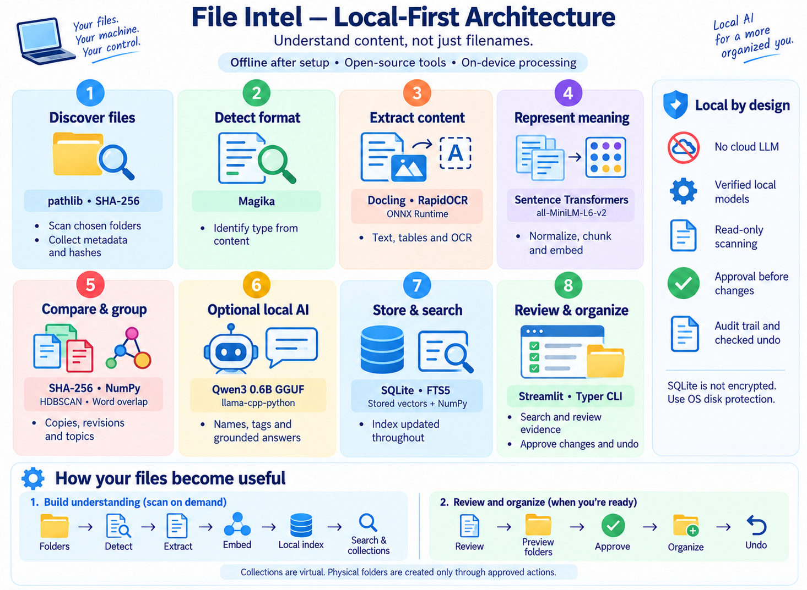

# File Intel

**Find, understand, and organize your documents by their content—not just their filenames.**

File Intel runs on your computer. It reads local documents, finds matching or related content, and helps you put files into useful folders. Once dependencies and models are installed, normal operation does not require an internet connection or an API key.

[Run locally](#run-locally) · [Architecture](#architecture) · [How decisions are made](#how-decisions-are-made) · [System design](#system-design) · [Improvements](#what-could-be-improved)

## What can I do with it?

| You want to… | Use… |
| --- | --- |
| Find a document by a phrase, filename, or idea | **Search**, with matching passages as evidence |
| Find exact copies, revisions, or shorter summaries | **Duplicates**, with reasons to review each match |
| Explore documents about the same topic across different formats | **Collections** |
| Put matching files from several folders into one folder | **Organize → Same content** |
| Ask a question about your indexed documents | **Search → Ask your library**, with passage citations |
| Review or undo proposed file changes | **Activity** |

**Example:** `plan.md`, `plan.txt`, and `plan.pdf` can share one destination folder when their complete extracted text matches. A revised budget stays separate under **Same content**, but can belong to the same topic **Collection**.

## Run locally

### Already set up on this Mac

Open Terminal in the project folder:

```sh
sh scripts/run_macos.command
```

Open **http://127.0.0.1:8501/**. Keep Terminal open while using the app. Press **Control+C** there to stop it. Run the same command to restart; you do not need to reinstall anything.

### First-time setup from GitHub

You need **Python 3.12**, Git, and internet access for the initial package/model downloads. The repository is private, so cloning requires GitHub access.

```sh
git clone https://github.com/rajeevranjanpandey/file-intel.git
cd file-intel
```

Create a fresh environment on this computer:

| macOS / Linux | Windows PowerShell |
| --- | --- |
| `python3.12 -m venv .venv-local` | `py -3.12 -m venv .venv-local` |
| `source .venv-local/bin/activate` | `.\.venv-local\Scripts\Activate.ps1` |

Then run these commands in that activated environment:

```sh
python -m pip install -r requirements.txt
python scripts/bundle_models.py
python -m app.cli models verify
python scripts/run.py
```

The model-bundling step downloads the local embedding, document/OCR, and Qwen models and records their hashes. **Model weights are not stored in GitHub.** If you already have a complete verified `models/` folder, copy it into the project and skip the download step.

If PowerShell blocks activation, use `.\.venv-local\Scripts\python.exe` in place of `python` for those commands. Native dependencies may require your operating system's C/C++ build tools. The complete environment and models occupy several GB; “small local model” does not mean the entire application is tiny.

### Install on a computer without internet

Bring Python 3.12, the project source, the complete verified `models/` folder, and a compatible `wheels/` bundle with `wheels/manifest.json`. Then, from the project folder:

```sh
python3.12 scripts/install.py --offline
python3.12 scripts/run.py
```

On Windows, use `py -3.12` instead of `python3.12`. The existing wheel bundle is for **Apple Silicon macOS / Python 3.12**; other platforms need their own bundle. The installer preserves existing environments and verifies wheels, dependencies, and models. See [deployment instructions](docs/DEPLOYMENT.md) for alternate environments and backups.

Keep the project and models outside cloud-synced folders for dependable offline use. Cloud documents must also be downloaded locally. A source snapshot ZIP does not contain the large models, wheels, or virtual environments.

### Try the sample workflow

1. **Library → Scan & Index:** read the included `demo/` documents, or connect your own folders.
2. **Search:** enter `Orion garden project`. Watch Scope → Match words → Compare meaning → Rank → Show evidence complete.
3. **Collections → Refresh collections:** browse topic groups. The top-right folder icon lists original files; clicking a filename reveals its location in your file manager.
4. **Organize → Same content → Preview folder structure:** inspect which matching files will share a folder. Select files across multiple source folders if needed.
5. **Create move proposals**, then review and approve them in **Activity**. Previewing and creating collections do not move files. Undo is available for completed actions when its safety checks pass.

### If it will not start

| Symptom | What to do |
| --- | --- |
| No compatible environment | Complete the first-time setup with Python 3.12. Do not copy a virtual environment between computers. |
| Missing or altered models | Restore a verified model bundle, or run the bundler while online, then verify again. |
| Port 8501 already in use | Open the running app, or stop its Terminal process before restarting. |
| Slow or blank startup from iCloud | Download the project files; preferably keep a local copy outside cloud storage. |
| Changes are not visible | Refresh the browser. Restart the app after Python-module changes. |

## Architecture

### Current architecture at a glance



The diagram shows the current implementation. Scans run on demand, the index is updated throughout processing, and local AI is optional. The table below explains each stage in more detail.

### What each tool does in the current build

| Stage | Implemented tools | Purpose and output |
| --- | --- | --- |
| 1. Discover files | Python `pathlib`, file metadata, SHA-256 | Scan connected roots and identify new or changed files. Manual scans; no background watcher. |
| 2. Detect type | **Magika** | Inspect content to identify the real format, even when the extension is misleading. |
| 3. Extract content | **Docling**, **RapidOCR / ONNX Runtime**, format-specific readers | Extract text, structure, tables, and page evidence. OCR reads supported scanned documents and images. |
| 4. Represent meaning | **Sentence Transformers**, **all-MiniLM-L6-v2**, Unicode normalization | Normalize text, create chunks, and turn them into vectors for comparison. An optional multilingual MiniLM can be installed separately. |
| 5. Compare and group | **SHA-256**, word-overlap rules, **NumPy**, **scikit-learn HDBSCAN** | Find exact/same-text matches, suggest revisions or summaries, and discover topic collections. |
| 6. Explain with local AI | **Qwen3 0.6B GGUF**, **llama-cpp-python** | Suggest collection names, descriptions, and tags; optionally write short answers from retrieved passages. CPU inference; no cloud LLM. |
| 7. Store and retrieve | **SQLite**, **FTS5**, vectors stored as binary data | Persist metadata, text, chunks, embeddings, collections, decisions, actions, and audit records. NumPy performs vector comparisons. |
| 8. Interact and act | **Streamlit**, **Typer CLI**, native file-manager integration | Search, review evidence, browse original locations, preview organization, approve changes, and undo them. |

RapidOCR supplies OCR; Python rules extract key facts. This build uses SQLite and Streamlit without a separate database server or web API.

## How decisions are made

There are three separate workflows. Storage happens throughout them, rather than only at the end of a pipeline.

**Indexing:** connected folders → file metadata and hashes → detected type → extracted text → normalized chunks and embeddings → local index. Unchanged indexed files are reused. Failed extraction is retried once, then marked for attention without moving the source file.

**Search:** query and filters → keyword matches in FTS5 + semantic matches from local embeddings → combined ranking → documents with supporting passages. The interface shows each stage. “Ask your library” uses retrieved passages and requires citations; a fallback quotes evidence when generation fails its checks.

**Organization:** matching content or topic collections → destination preview → proposed actions → user approval → checked file operation → audit record. Undo checks file integrity before restoring the original location.

| Decision | Rule | Meaning for the user |
| --- | --- | --- |
| Are these exact copies? | Equal file SHA-256 hashes | The complete file bytes match. |
| Is the text the same across formats? | Both extractions completed; normalized text hashes match | A PDF, Markdown file, and text file can be grouped. Layout, images, and metadata may still differ. |
| Is one an edited version? | Shared wording or sufficiently high semantic similarity | A review suggestion with changed-word evidence—not proof that one file is disposable. |
| Is one a summary or excerpt? | Shorter length plus copied wording, or semantic similarity anchored by shared figures | Related content, not an exact duplicate. Summaries are not offered for removal. |
| Do these files share a topic? | HDBSCAN clusters document vectors | A suggested collection. Ambiguous documents can remain **Not yet grouped**. |
| Can the AI choose a name? | Representative excerpts and keywords, constrained JSON output | Optional readable labels. Keyword labels remain available if the model fails. |
| May a file be moved? | Approved action, allowed path, matching source hash, safe destination | Refuse overwrites and unsupported cross-volume moves. The LLM never authorizes a move. |

**Collections are virtual groups. Organize creates physical folders only when approved actions run.** Date-based organization uses last-modified dates, not dates inferred from document content.

## System design

The app is a local Python application with a browser interface bound to `127.0.0.1:8501`. It does not require a hosted API or separate database service. Streamlit and the CLI share the same application modules.

| Code | Responsibility |
| --- | --- |
| [`ui/`](ui/) | Screens, collection navigation, progress, and review controls |
| [`app/discover.py`](app/discover.py), [`app/extract.py`](app/extract.py) | File discovery and bounded document extraction |
| [`app/represent.py`](app/represent.py), [`app/search.py`](app/search.py) | Text/vector representations and retrieval |
| [`app/analyze.py`](app/analyze.py), [`app/ask.py`](app/ask.py) | Duplicate relationships, topic grouping, and grounded answers |
| [`app/local_model.py`](app/local_model.py) | Local language-model inference in an isolated process |
| [`app/organize.py`](app/organize.py), [`app/actions.py`](app/actions.py) | Folder plans, approval checks, execution, and undo |
| [`app/store.py`](app/store.py), [`app/guard.py`](app/guard.py) | SQLite persistence, integrity checks, and access/network controls |
| [`config.toml`](config.toml) | Connected roots, storage paths, extraction limits, and model settings |
| [`scripts/`](scripts/), [`tests/`](tests/) | Installation, model preparation, launchers, and regression checks |

Parser and language-model work runs in separate processes with time limits, so a bad document or native-model failure can be contained. Model files are checked against their manifest. SQLite records durable action intent and a hash-linked audit trail; recovery can reconcile interrupted file operations.

### Privacy and safety boundaries

- Document processing and inference use local models. Python network controls block outbound application connections during normal operation; setup/model downloads are a separate online step.
- These controls are **not an operating-system firewall**. Other applications and cloud-sync services can still access the network.
- Scanning reads source files. Approved organization actions deliberately change their locations. Soft deletion uses recovery storage rather than permanent deletion.
- The current SQLite index stores extracted content **without application-level encryption**. Protect the computer and its backups with appropriate OS controls; SQLCipher is a possible future improvement.
- The audit chain detects certain modifications, but is not a digital signature against someone able to rewrite the entire database.

## What could be improved?

| Area | Current limitation | Useful next step |
| --- | --- | --- |
| Search relevance | Lower-ranked semantic results can be loosely related | Calibrate relevance cutoffs and evaluate optional reranking on real queries. |
| Large libraries | Pairwise comparisons can grow quadratically; vector search scans stored vectors | Benchmark realistic libraries, then introduce candidate indexing or a local vector index. |
| Grouping quality | Topic groups and version/summary detection are suggestions and heuristics | Evaluate on human-labelled documents across formats and languages. |
| Arabic and multilingual use | English MiniLM is the default; another model is optional | Measure retrieval and grouping quality before claiming language coverage. |
| Offline distribution | Python, native dependencies, models, and platform-specific wheels must be prepared | Produce tested, versioned installers for each supported platform. |
| Data protection | Local index is not application-encrypted | Add encryption, key management, and tested backup/restore procedures. |
| Freshness and file support | Manual rescans; some formats remain metadata-only or partially extracted | Add controlled background monitoring and broaden extraction coverage. |

Small synthetic tests demonstrate specific behavior; they do not establish production-scale accuracy, universal format support, or fully reliable AI answers.

## Testing and further reading

For a fresh online setup, install the test tools into the activated environment:

```sh
python -m pip install pytest ruff
python scripts/run.py --python -m pytest -q
python scripts/run.py --python scripts/verify_grouping_test.py
```

The offline lockfile already includes the test tools. Real parser/model tests take several minutes and use temporary copies for move/undo checks. On this Mac, the last full run passed **68 tests** before the collection-navigation update; the subsequent focused navigation/location run passed **5 tests**. These are historical checks, not a claim that every future environment will behave identically.

- [Detailed operations and CLI reference](docs/OPERATIONS.md)
- [Deployment and backups](docs/DEPLOYMENT.md)
- [Technical architecture](docs/ARCHITECTURE.md)
- [Tool research](docs/RESEARCH.md)
- [Validation scope and limitations](docs/VALIDATION.md)
- [Third-party licenses](docs/THIRD_PARTY.json)

Project code is [MIT licensed](LICENSE). Dependencies and model weights retain their own licenses.
